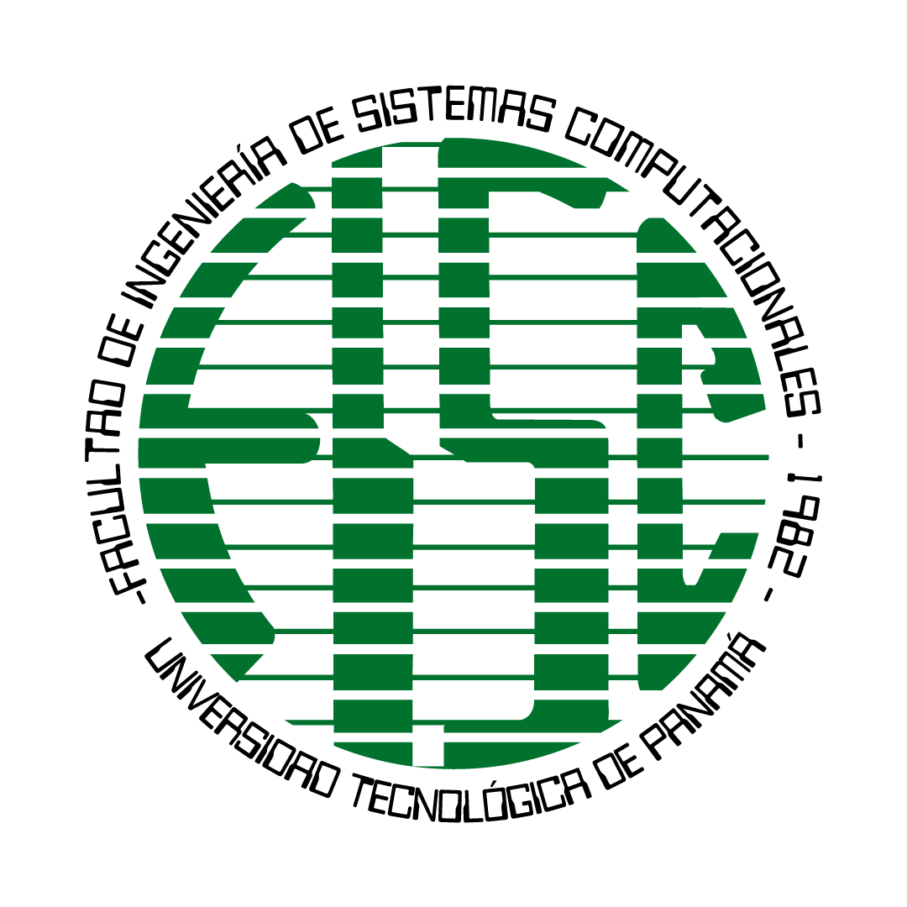
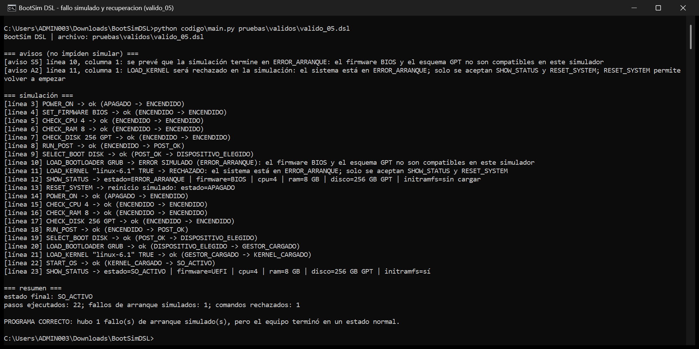
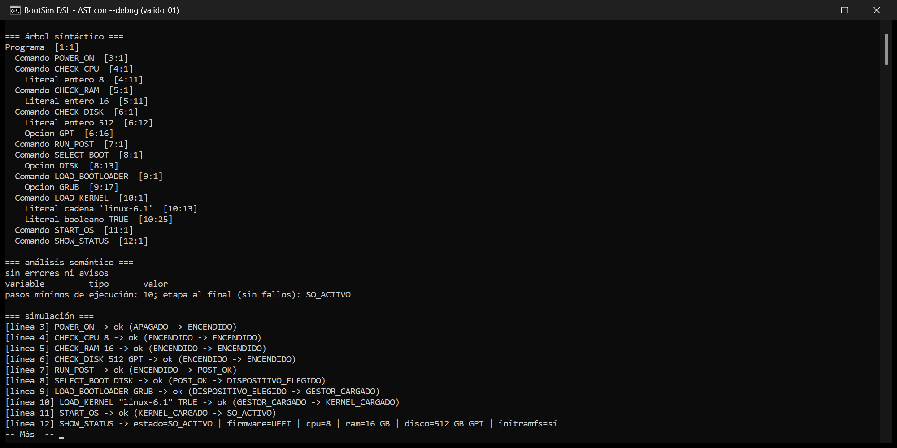
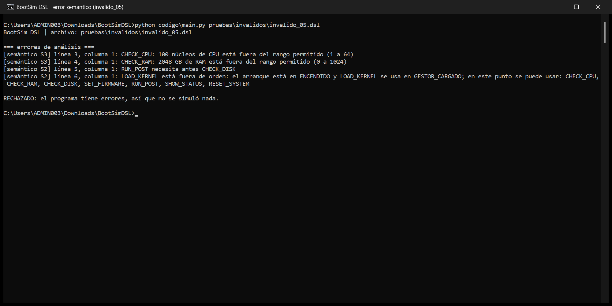

# BootSim DSL

**Simulación del sistema de arranque de una computadora mediante un lenguaje específico de dominio.**

Proyecto final de *Lenguajes Formales, Autómatas y Compiladores* · Grupo 1IL-143 · Segundo semestre 2026 · Facultad de Ingeniería de Sistemas Computacionales (FISC), Universidad Tecnológica de Panamá (UTP).

<p>
  
  &nbsp;&nbsp;
  
</p>

## Qué es

BootSim DSL es un lenguaje pequeño para **describir** cómo arranca una computadora (encendido, POST, BIOS o UEFI, gestor de arranque GRUB, kernel y sistema operativo) y un programa que **simula ese arranque en pantalla**, incluidos los fallos (memoria que no se detecta, firmware y disco incompatibles, *kernel panic*) y la recuperación con un reinicio.

Todo ocurre **en la memoria del programa**: no toca el firmware, los discos, las particiones ni el arranque de Windows o Linux del equipo donde se ejecuta.

Un ejemplo (`pruebas/validos/valido_05.dsl`, fragmento):

```
POWER_ON;
SET_FIRMWARE BIOS;
CHECK_CPU 4;
CHECK_RAM memoria;
CHECK_DISK 256 GPT;        # BIOS con GPT: en BootSim no son compatibles
RUN_POST;
SELECT_BOOT DISK;
LOAD_BOOTLOADER GRUB;      # aquí falla: ERROR_ARRANQUE
RESET_SYSTEM;              # única salida de un estado de error
POWER_ON;                  # el firmware vuelve a UEFI y todo sigue bien
```

## Cómo funciona

```
archivo .dsl
   │  main.py lee el archivo (UTF-8, con o sin BOM)
   ▼
lexer.py + parser.py (PLY 3.11) ──► árbol del programa (AST)      ¿errores léxicos o sintácticos? → RECHAZADO, no se simula
   ▼
semantica.py (valida el árbol sin ejecutar nada)                  ¿errores semánticos? → RECHAZADO, no se simula
   ▼   (los avisos se muestran pero no bloquean)
simulador.py (recorre el árbol sobre una máquina de estados)  ──►  resumen y código de salida
```

| Archivo | Para qué sirve |
| --- | --- |
| `codigo/lexer.py` | PLY: parte el texto en tokens y avisa de caracteres inválidos con línea y columna |
| `codigo/parser.py` | PLY: gramática LALR, precedencia explícita, recuperación de errores; entrega el AST |
| `codigo/ast_nodos.py` | los nodos del árbol y el patrón *visitante* |
| `codigo/semantica.py` | variables, tipos, orden de etapas, límites de CPU/RAM/disco, división entre cero, límite de pasos |
| `codigo/reglas_arranque.py` | estados, transiciones y fallos simulados (los comparten la semántica y el simulador) |
| `codigo/simulador.py` | ejecuta el AST: variables, `IF`, `REPEAT`, `BEGIN/END` y la máquina de estados |
| `codigo/main.py` | línea de comandos: `--debug`, códigos de salida, mensajes claros |

**Estados:** `APAGADO → ENCENDIDO → POST_OK → DISPOSITIVO_ELEGIDO → GESTOR_CARGADO → KERNEL_CARGADO → SO_ACTIVO`, y tres estados de error (`ERROR_POST`, `ERROR_ARRANQUE`, `KERNEL_PANIC`) de los que solo se sale con `RESET_SYSTEM`.

**Comandos (12):** `POWER_ON`, `CHECK_CPU`, `CHECK_RAM`, `CHECK_DISK`, `SET_FIRMWARE`, `RUN_POST`, `SELECT_BOOT`, `LOAD_BOOTLOADER`, `LOAD_KERNEL`, `START_OS`, `SHOW_STATUS`, `RESET_SYSTEM`; más variables (`SET`), expresiones aritméticas, relacionales y booleanas, `IF/THEN/ELSE/ENDIF`, `REPEAT/TIMES/ENDREPEAT`, `BEGIN/END` y comentarios `#` y `//`.

## Requisitos e instalación

- Python **3.10 o superior** (probado a mano con 3.12 en Windows y con 3.14 en Ubuntu bajo WSL; el flujo de GitHub Actions ejecuta las pruebas con 3.10 y 3.12 en Linux y Windows; su primera corrida, el 2026-11-21, terminó en verde en las cuatro combinaciones).
- PLY 3.11, la biblioteca que construye el lexer y el parser:

```
pip install -r codigo/requirements.txt
```

## Uso

Desde la carpeta del proyecto:

| Dónde | Comando |
| --- | --- |
| Windows (CMD o PowerShell) | `python codigo\main.py pruebas\validos\valido_01.dsl` |
| Linux o macOS | `python3 codigo/main.py pruebas/validos/valido_01.dsl` |
| Lanzadores | `codigo\run.bat ARCHIVO.dsl` (CMD) · `sh codigo/run ARCHIVO.dsl` (Linux) |

Con `--debug` se ven, además de la simulación, los **tokens**, el **árbol (AST)** con sangrías, los diagnósticos de la semántica y la traza de los `IF` y `REPEAT`.

**Códigos de salida:** `0` programa correcto y el equipo simulado no termina en error · `1` errores léxicos, sintácticos o semánticos (no se simula nada) · `2` argumentos incorrectos · `3` problema con el archivo · `4` programa correcto pero el arranque simulado termina en un estado de error · `5` error de ejecución (por ejemplo, más de 10 000 pasos) · `70` fallo interno o dependencia faltante.

Más detalles y solución de problemas: [`codigo/README.md`](codigo/README.md).

## Pruebas

Los diez programas de ejemplo están en [`pruebas/validos/`](pruebas/validos) y [`pruebas/invalidos/`](pruebas/invalidos); sus resultados reales, uno por uno, en [`docs/capitulos/05_pruebas.md`](docs/capitulos/05_pruebas.md).

```
python codigo/probar_lexer.py        # 104 pruebas
python codigo/probar_parser.py       # 145 pruebas
python codigo/probar_semantica.py    # 305 pruebas
python codigo/probar_simulador.py    # 174 pruebas (lanza main.py muchas veces; alrededor de un minuto)
python codigo/probar_programas.py    # 132 comprobaciones sobre los diez programas
```

Otras comprobaciones (se corren a mano, tardan varios minutos): `mutaciones_*.py` rompe el código a propósito en una copia y comprueba que las pruebas lo notan (27 de 27 mutaciones del simulador y 22 de 22 de la semántica detectadas); `comparar_*_borrador.py` compara el código definitivo con los prototipos del diseño en decenas de miles de programas al azar. Las salidas reales están en [`evidencias/`](evidencias). GitHub Actions ejecuta las cinco pruebas de arriba en Linux y Windows.

Las pruebas las escribió una IA: **no sustituyen** una verificación independiente hecha por el equipo.

## Capturas

Imágenes reales de CMD de Windows (cómo se tomaron y sus límites: [`evidencias/capturas/LEEME.md`](evidencias/capturas/LEEME.md)).

| Arranque con fallo simulado y recuperación | AST con `--debug` |
| --- | --- |
|  |  |

| Error semántico (límites y orden de etapas) |
| --- |
|  |

## Demostración en el navegador

La carpeta [`sitio/`](sitio/LEEME.md) contiene una página para GitHub Pages que ejecuta **este mismo código Python** (con PLY 3.11) dentro del navegador, mediante Pyodide. Permite elegir los diez programas de ejemplo o escribir uno propio, y muestra la salida exacta de la terminal, los tokens, el árbol, la semántica y un diagrama animado de los estados del arranque. El flujo de publicación compara la salida del navegador con la de la terminal (en Linux y en Windows) y no publica si difieren; cómo se hace y qué límites tiene está en [`sitio/LEEME.md`](sitio/LEEME.md). Dirección prevista, cuando el equipo active Pages: `https://charrixxz23.github.io/bootsim-dsl-lfac/`.

## Estructura del repositorio

```
assets/logos/        logos de la UTP y de la FISC
codigo/              lexer, parser, AST, semántica, simulador, línea de comandos y pruebas
pruebas/             los diez programas .dsl (5 válidos y 5 inválidos)
sitio/               página de demostración (Pyodide) y su prueba de paridad con la terminal
docs/                capítulos, anexos, bitácora de decisiones e índice
evidencias/          salidas reales de las pruebas, mutaciones, comparaciones y capturas
scripts/             captura de pantalla de CMD y comprobación de formato de documentos Word
.github/workflows/   pruebas automáticas y publicación de la página
```

## Estado

Proyecto académico en desarrollo. Las fases de diseño, lexer, parser, semántica, simulador y pruebas están completas; el informe técnico en Word, la bitácora y la declaración de IA en su versión final, las reflexiones individuales y el video **están pendientes** y los completa el equipo. No hay licencia elegida todavía: es una decisión del equipo.

## Créditos

Equipo del grupo 1IL-143:

| Integrante | Responsabilidad principal |
| --- | --- |
| Richard Smith | POST, BIOS/UEFI y lexer |
| Víctor Sánchez | GRUB, MBR/GPT, kernel, gramática y parser |
| Juan González | AST, semántica, simulación y errores |
| Jorge González | introducción, problema, objetivos, glosario y pruebas explicadas |
| Alexandra Esteves | conclusiones, mantenimiento, consolidación y formato |
| Marc Chavarría | integración, pruebas, auditoría técnica y preparación de la defensa |

Los seis deben entender el proyecto completo. Roles de la defensa y reparto del video: [`docs/EQUIPO_Y_ROLES.md`](docs/EQUIPO_Y_ROLES.md).

**Nota sobre Marc Chavarría.** Se incorporó al equipo el 2026-11-21, cuando las fases F01 a F09 ya estaban hechas. Las responsabilidades de la tabla son las que se le **asignaron** al incorporarse; el código, las pruebas y los commits de este repositorio hasta esa fecha **no incluyen aportes suyos**, y los suyos se registrarán cuando existan. Quien quiera figurar como colaborador de GitHub lo hará con su propia cuenta.

## Declaración transparente sobre el uso de inteligencia artificial

- **ChatGPT** ayudó a elaborar el índice aprobado del proyecto, a diseñar la *Skill* de trabajo y a orquestar el plan por fases.
- **Claude Code** (modelo `claude-sonnet-5-5`) desarrolló, bajo la dirección del equipo y por fases, el diseño técnico, el lexer, el parser, el AST, la semántica, el simulador, la línea de comandos, las pruebas, las capturas y los capítulos de documentación.
- El equipo aprobó el plan de diseño (fase F03) mediante el control de avance del proyecto. **El resto del código, las pruebas y los textos fueron generados por IA y están pendientes de revisión humana.** Las pruebas, los resultados y las capturas son reales y reproducibles, pero el equipo todavía no las ha repetido.
- La bitácora de decisiones, [`docs/BITACORA_EN_CURSO.md`](docs/BITACORA_EN_CURSO.md), registra las decisiones y los **errores reales de la IA** encontrados (por ejemplo, un lanzador roto en Windows, tildes rotas por tuberías en CMD y una prueba que daba por buena una excepción). Se indica cuáles evidencias no se guardaron.
- Las firmas, las reflexiones individuales y las revisiones humanas son del equipo y no las genera ninguna herramienta. Se actualizará esta declaración si se usan otras herramientas.
