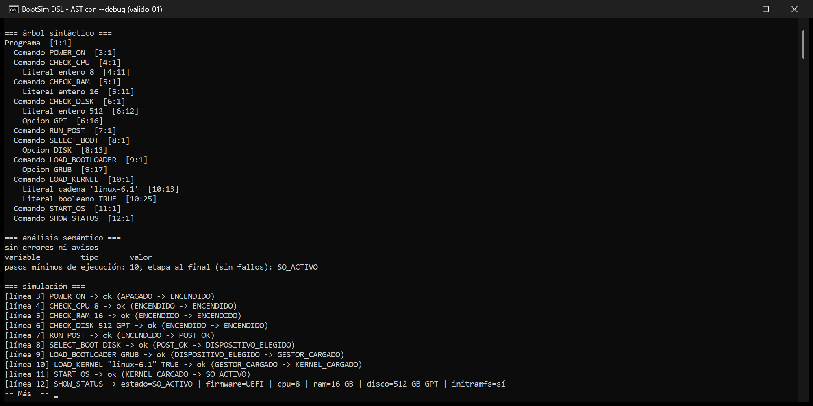
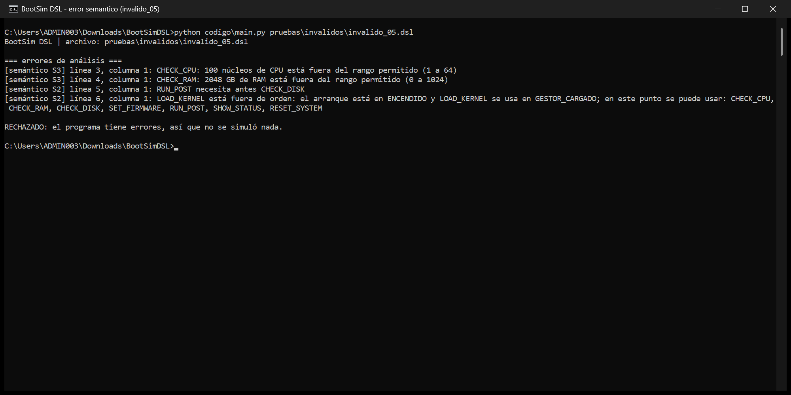

# 5. Pruebas

Este capítulo muestra los diez programas definitivos de BootSim DSL (cinco válidos y cinco inválidos), cómo se ejecutaron y qué resultado dieron de verdad. La teoría de cada etapa (lexer, parser, semántica, simulador) está en los capítulos anteriores y no se repite aquí.

> **Cómo se hizo.** Cada programa se ejecutó con la aplicación real, `python codigo/main.py ARCHIVO.dsl`, desde la carpeta del proyecto, y se guardó la salida completa de terminal de cada ejecución (normal y con `--debug`) en `evidencias/f09_salidas/`. Los resultados «esperados» se calcularon **a mano al diseñar cada programa**, antes de ejecutarlo; el verificador `codigo/probar_programas.py` (132 comprobaciones) compara lo esperado con lo real. El verificador y las capturas los preparó una IA (Claude Code); ningún integrante del equipo ha repetido todavía estas pruebas.

## 5.1 Los diez casos de un vistazo

| # | Archivo | Qué demuestra | Resultado | Código de salida | Evidencia |
| --- | --- | --- | --- | --- | --- |
| 1 | `pruebas/validos/valido_01.dsl` | Arranque completo y correcto hasta SO_ACTIVO, con comentarios # y // | **Aceptado.** Estado final `SO_ACTIVO`, 10 pasos, sin fallos | 0 | `evidencias/f09_salidas/valido_01.txt` |
| 2 | `pruebas/validos/valido_02.dsl` | Variables y expresiones aritméticas, relacionales y booleanas | **Aceptado.** Estado final `POST_OK`, 14 pasos, sin fallos | 0 | `evidencias/f09_salidas/valido_02.txt` |
| 3 | `pruebas/validos/valido_03.dsl` | IF/THEN/ELSE con BEGIN/END y un IF anidado | **Aceptado.** Estado final `SO_ACTIVO`, 15 pasos, sin fallos | 0 | `evidencias/f09_salidas/valido_03.txt` |
| 4 | `pruebas/validos/valido_04.dsl` | REPEAT/ENDREPEAT (anidado y con cero vueltas) y comentarios | **Aceptado.** Estado final `POST_OK`, 20 pasos, sin fallos | 0 | `evidencias/f09_salidas/valido_04.txt` |
| 5 | `pruebas/validos/valido_05.dsl` | Fallo de arranque simulado (BIOS con GPT), RESET_SYSTEM y continuación hasta SO_ACTIVO | **Aceptado.** Estado final `SO_ACTIVO`, 22 pasos, 1 fallo simulado y 1 comando rechazado; avisos: S5 línea 10, A2 línea 11 | 0 | `evidencias/f09_salidas/valido_05.txt` |
| 6 | `pruebas/invalidos/invalido_01.dsl` | Error léxico: un carácter que el lenguaje no reconoce | **Rechazado:** error léxico en 3:13. No se simula. | 1 | `evidencias/f09_salidas/invalido_01.txt` |
| 7 | `pruebas/invalidos/invalido_02.dsl` | Error sintáctico: instrucción incompleta (a CHECK_DISK le falta el esquema) | **Rechazado:** error sintáctico en 4:15. No se simula. | 1 | `evidencias/f09_salidas/invalido_02.txt` |
| 8 | `pruebas/invalidos/invalido_03.dsl` | Error sintáctico en una estructura: REPEAT sin ENDREPEAT | **Rechazado:** error sintáctico en 6:1. No se simula. | 1 | `evidencias/f09_salidas/invalido_03.txt` |
| 9 | `pruebas/invalidos/invalido_04.dsl` | Errores semánticos: variable sin valor y tipos incompatibles | **Rechazado:** error semántico S1 en 2:13; error semántico S4 en 3:16. No se simula. | 1 | `evidencias/f09_salidas/invalido_04.txt` |
| 10 | `pruebas/invalidos/invalido_05.dsl` | Errores semánticos: límites fuera de rango y orden de etapas | **Rechazado:** error semántico S3 en 3:1; error semántico S3 en 4:1; error semántico S2 en 5:1; error semántico S2 en 6:1. No se simula. | 1 | `evidencias/f09_salidas/invalido_05.txt` |

Códigos de salida (política de F08, pendiente de confirmar por el equipo): **0** = programa correcto y el equipo simulado no terminó en un estado de error; **1** = errores léxicos, sintácticos o semánticos (no se simuló nada). Ninguno de los diez termina con el equipo en error, así que los otros códigos (4 por fallo de arranque que no se recupera, 5 por error de ejecución) se prueban con otros programas en `evidencias/f08_simulacion.txt`.

## 5.2 Programas válidos

### Válido 1: Arranque completo y correcto hasta SO_ACTIVO, con comentarios # y //

**Archivo:** `pruebas/validos/valido_01.dsl`

```
# valido 1: arranque completo y correcto, de POWER_ON hasta SO_ACTIVO
// los dos tipos de comentario (# y //) valen igual
POWER_ON;                      # se enciende el equipo
CHECK_CPU 8;                   # 8 nucleos
CHECK_RAM 16;                  # 16 GB de memoria
CHECK_DISK 512 GPT;            # disco de 512 GB con esquema GPT
RUN_POST;                      // autodiagnostico del hardware
SELECT_BOOT DISK;              // se arranca desde el disco
LOAD_BOOTLOADER GRUB;          // se carga el gestor de arranque
LOAD_KERNEL "linux-6.1" TRUE;  // kernel con initramfs
START_OS;                      // inicia el sistema operativo
SHOW_STATUS;                   // muestra el estado final
```

**Comando exacto:** `python codigo/main.py pruebas/validos/valido_01.dsl` (en CMD: `python codigo\main.py pruebas\validos\valido_01.dsl`)

**Resultado esperado (calculado a mano):** aceptado; SO_ACTIVO tras 10 pasos; sin avisos; código 0.

**Resultado real:** código de salida **0**. Extracto de la salida (la salida completa está en `evidencias/f09_salidas/valido_01.txt`):

```
[línea 12] SHOW_STATUS -> estado=SO_ACTIVO | firmware=UEFI | cpu=8 | ram=16 GB | disco=512 GB GPT | initramfs=sí
estado final: SO_ACTIVO
pasos ejecutados: 10; fallos de arranque simulados: 0; comandos rechazados: 0
PROGRAMA CORRECTO: la simulación terminó sin fallos de arranque.
```

**Con `--debug`** (código 0, `evidencias/f09_salidas/valido_01_debug.txt`): salen las siete secciones (tokens, árbol, análisis semántico, simulación, traza, variables y resumen); en este caso: tokens (`POWER_ON`, `ENTERO`, ...), árbol con `Comando` y `Literal`, tabla de variables vacía y simulación.

**Qué demuestra, en palabras simples:** Es el arranque «de manual», sin sorpresas. Se enciende el equipo, se miden CPU, RAM y disco, se hace el autodiagnóstico (POST), se elige el disco, se carga el gestor de arranque (GRUB) y el kernel y se inicia el sistema. Cada comando solo vale en su etapa, y aquí todos llegan en orden. También muestra que los comentarios `#` y `//` se ignoran.

### Válido 2: Variables y expresiones aritméticas, relacionales y booleanas

**Archivo:** `pruebas/validos/valido_02.dsl`

```
# valido 2: variables, aritmetica, comparaciones y logica
SET nucleos = 2 * 4;                        # 8
SET memoria = (8 + 8) / 2 + 4;              # 12 (la division es entera)
SET resta = 0 - 7 / 2;                      # -3: se trunca hacia cero
SET invertido = -memoria;                   # -12
SET suficiente = memoria >= 8 AND NOT (nucleos < 2);   # TRUE
SET igualdad = (nucleos == 8) != (memoria == 8);       # TRUE != FALSE = TRUE
SET alguna = nucleos > 100 OR suficiente;              # TRUE
SET cabe = memoria <= 16;                              # TRUE
POWER_ON;
CHECK_CPU nucleos;
CHECK_RAM memoria;
CHECK_DISK 256 MBR;
RUN_POST;
SHOW_STATUS;
```

**Comando exacto:** `python codigo/main.py pruebas/validos/valido_02.dsl` (en CMD: `python codigo\main.py pruebas\validos\valido_02.dsl`)

**Resultado esperado (calculado a mano):** aceptado; POST_OK tras 14 pasos; variables `nucleos=8, memoria=12, resta=-3, invertido=-12` y `suficiente, igualdad, alguna, cabe` en `TRUE`; código 0.

**Resultado real:** código de salida **0**. Extracto de la salida (la salida completa está en `evidencias/f09_salidas/valido_02.txt`):

```
[línea 15] SHOW_STATUS -> estado=POST_OK | firmware=UEFI | cpu=8 | ram=12 GB | disco=256 GB MBR | initramfs=sin cargar
estado final: POST_OK
pasos ejecutados: 14; fallos de arranque simulados: 0; comandos rechazados: 0
PROGRAMA CORRECTO: la simulación terminó sin fallos de arranque.
```

**Con `--debug`** (código 0, `evidencias/f09_salidas/valido_02_debug.txt`): salen las siete secciones (tokens, árbol, análisis semántico, simulación, traza, variables y resumen); en este caso: tokens como `MENORIGUAL`, árbol con `BinOp` y `UnOp`, y las ocho variables con su valor final.

**Qué demuestra, en palabras simples:** Aquí el programa «hace cuentas» antes de arrancar: usa variables (`SET`), suma, resta, multiplica y divide (la división es entera: `7 / 2` da `3`, y `0 - 7 / 2` da `-3`), compara (`>=`, `<=`, `<`, `>`, `==`, `!=`) y combina verdadero/falso con `AND`, `OR`, `NOT`. Los resultados alimentan los comandos (`CHECK_CPU nucleos`). Un entero y un booleano nunca se mezclan: por eso `igualdad` compara dos booleanos y no un booleano con un número.

### Válido 3: IF/THEN/ELSE con BEGIN/END y un IF anidado

**Archivo:** `pruebas/validos/valido_03.dsl`

```
# valido 3: IF/THEN/ELSE con BEGIN/END y un IF dentro de otro
SET ram = 8;
SET usa_uefi = ram >= 16;
POWER_ON;
IF usa_uefi THEN
  BEGIN
    SET_FIRMWARE UEFI;
    CHECK_DISK 512 GPT;
  END
ELSE
  BEGIN
    SET_FIRMWARE BIOS;
    CHECK_DISK 512 MBR;
    IF ram < 4 THEN
      CHECK_CPU 1;
    ELSE
      CHECK_CPU 4;
    ENDIF
  END
ENDIF
CHECK_RAM ram;
RUN_POST;
SELECT_BOOT DISK;
LOAD_BOOTLOADER GRUB;
LOAD_KERNEL "linux-5.15" TRUE;
START_OS;
SHOW_STATUS;
```

**Comando exacto:** `python codigo/main.py pruebas/validos/valido_03.dsl` (en CMD: `python codigo\main.py pruebas\validos\valido_03.dsl`)

**Resultado esperado (calculado a mano):** aceptado; corre la rama ELSE; SO_ACTIVO con BIOS/MBR tras 15 pasos; código 0.

**Resultado real:** código de salida **0**. Extracto de la salida (la salida completa está en `evidencias/f09_salidas/valido_03.txt`):

```
[línea 12] SET_FIRMWARE BIOS -> ok (ENCENDIDO -> ENCENDIDO)
[línea 27] SHOW_STATUS -> estado=SO_ACTIVO | firmware=BIOS | cpu=4 | ram=8 GB | disco=512 GB MBR | initramfs=sí
estado final: SO_ACTIVO
pasos ejecutados: 15; fallos de arranque simulados: 0; comandos rechazados: 0
PROGRAMA CORRECTO: la simulación terminó sin fallos de arranque.
```

**Con `--debug`** (código 0, `evidencias/f09_salidas/valido_03_debug.txt`): salen las siete secciones (tokens, árbol, análisis semántico, simulación, traza, variables y resumen); en este caso: árbol con `Si`, sus ramas `entonces:` y `sino:` y `Bloque`, y la traza «la condición vale FALSE, se ejecuta la rama ELSE» (dos veces).

**Qué demuestra, en palabras simples:** Toma una decisión con `IF/THEN/ELSE`. Como `ram = 8` no llega a 16, `usa_uefi` vale `FALSE` y corre la rama `ELSE`: firmware BIOS y disco MBR (una pareja compatible). Dentro de esa rama hay otro `IF` (¿menos de 4 GB?) y los grupos `BEGIN ... END` agrupan varias instrucciones. La rama que no corre (UEFI) también se revisó antes de simular, pero no se ejecutó.

### Válido 4: REPEAT/ENDREPEAT (anidado y con cero vueltas) y comentarios

**Archivo:** `pruebas/validos/valido_04.dsl`

```
# valido 4: REPEAT/ENDREPEAT (tambien anidado y con cero vueltas) y comentarios
POWER_ON;
SET vueltas = 3;
REPEAT vueltas TIMES             # se repite 3 veces
  CHECK_CPU 2;
  REPEAT 2 TIMES                 // y por cada vuelta, dos veces mas
    SHOW_STATUS;
  ENDREPEAT
ENDREPEAT
REPEAT 0 TIMES                   # con cero vueltas el cuerpo no se ejecuta
  CHECK_RAM 1;
ENDREPEAT
CHECK_RAM 8;
CHECK_DISK 128 GPT;
RUN_POST;
SHOW_STATUS;
```

**Comando exacto:** `python codigo/main.py pruebas/validos/valido_04.dsl` (en CMD: `python codigo\main.py pruebas\validos\valido_04.dsl`)

**Resultado esperado (calculado a mano):** aceptado; 7 `SHOW_STATUS` (6 + 1); POST_OK tras 20 pasos; código 0.

**Resultado real:** código de salida **0**. Extracto de la salida (la salida completa está en `evidencias/f09_salidas/valido_04.txt`):

```
[línea 7] SHOW_STATUS -> estado=ENCENDIDO | firmware=UEFI | cpu=2 | ram=sin leer | disco=sin leer | initramfs=sin cargar
[línea 7] SHOW_STATUS -> estado=ENCENDIDO | firmware=UEFI | cpu=2 | ram=sin leer | disco=sin leer | initramfs=sin cargar
[línea 7] SHOW_STATUS -> estado=ENCENDIDO | firmware=UEFI | cpu=2 | ram=sin leer | disco=sin leer | initramfs=sin cargar
[línea 7] SHOW_STATUS -> estado=ENCENDIDO | firmware=UEFI | cpu=2 | ram=sin leer | disco=sin leer | initramfs=sin cargar
[línea 7] SHOW_STATUS -> estado=ENCENDIDO | firmware=UEFI | cpu=2 | ram=sin leer | disco=sin leer | initramfs=sin cargar
[línea 7] SHOW_STATUS -> estado=ENCENDIDO | firmware=UEFI | cpu=2 | ram=sin leer | disco=sin leer | initramfs=sin cargar
[línea 16] SHOW_STATUS -> estado=POST_OK | firmware=UEFI | cpu=2 | ram=8 GB | disco=128 GB GPT | initramfs=sin cargar
estado final: POST_OK
pasos ejecutados: 20; fallos de arranque simulados: 0; comandos rechazados: 0
PROGRAMA CORRECTO: la simulación terminó sin fallos de arranque.
```

**Con `--debug`** (código 0, `evidencias/f09_salidas/valido_04_debug.txt`): salen las siete secciones (tokens, árbol, análisis semántico, simulación, traza, variables y resumen); en este caso: árbol con `Repetir` anidado y la traza de cuántas veces corre cada cuerpo (3, 2, 2, 2 y 0).

**Qué demuestra, en palabras simples:** Repite instrucciones con `REPEAT`. El de afuera da 3 vueltas (la cantidad sale de la variable `vueltas`) y por cada vuelta uno de adentro repite 2 veces `SHOW_STATUS`: 6 veces en total. Un `REPEAT 0` no ejecuta su cuerpo (la RAM que pone ahí, `CHECK_RAM 1`, nunca se usa y por eso la RAM final es 8). Los comentarios van al final de las líneas.

### Válido 5: Fallo de arranque simulado (BIOS con GPT), RESET_SYSTEM y continuación hasta SO_ACTIVO

**Archivo:** `pruebas/validos/valido_05.dsl`

```
# valido 5: un fallo de arranque simulado, recuperacion con RESET_SYSTEM y continuacion
SET memoria = 8;               # esta variable sobrevive al reinicio
POWER_ON;
SET_FIRMWARE BIOS;             # bios...
CHECK_CPU 4;
CHECK_RAM memoria;
CHECK_DISK 256 GPT;            # ...con un disco gpt: no son compatibles en BootSim
RUN_POST;
SELECT_BOOT DISK;
LOAD_BOOTLOADER GRUB;          # aqui falla: ERROR_ARRANQUE
LOAD_KERNEL "linux-6.1" TRUE;  # se rechaza porque el sistema esta en error
SHOW_STATUS;
RESET_SYSTEM;                  # unica salida de un estado de error
POWER_ON;                      # el firmware vuelve a UEFI, que si acepta gpt
CHECK_CPU 4;
CHECK_RAM memoria;
CHECK_DISK 256 GPT;
RUN_POST;
SELECT_BOOT DISK;
LOAD_BOOTLOADER GRUB;
LOAD_KERNEL "linux-6.1" TRUE;
START_OS;
SHOW_STATUS;
```

**Comando exacto:** `python codigo/main.py pruebas/validos/valido_05.dsl` (en CMD: `python codigo\main.py pruebas\validos\valido_05.dsl`)

**Resultado esperado (calculado a mano):** aceptado con 2 avisos (S5, A2); 1 fallo simulado y 1 rechazo; SO_ACTIVO tras 22 pasos; código 0.

**Resultado real:** código de salida **0**. Extracto de la salida (la salida completa está en `evidencias/f09_salidas/valido_05.txt`):

```
[aviso S5] línea 10, columna 1: se prevé que la simulación termine en ERROR_ARRANQUE: el firmware BIOS y el esquema GPT no son compatibles en este simulador
[aviso A2] línea 11, columna 1: LOAD_KERNEL será rechazado en la simulación: el sistema está en ERROR_ARRANQUE; solo se aceptan SHOW_STATUS y RESET_SYSTEM; RESET_SYSTEM permite volver a empezar
[línea 10] LOAD_BOOTLOADER GRUB -> ERROR SIMULADO (ERROR_ARRANQUE): el firmware BIOS y el esquema GPT no son compatibles en este simulador
[línea 11] LOAD_KERNEL "linux-6.1" TRUE -> RECHAZADO: el sistema está en ERROR_ARRANQUE; solo se aceptan SHOW_STATUS y RESET_SYSTEM
[línea 12] SHOW_STATUS -> estado=ERROR_ARRANQUE | firmware=BIOS | cpu=4 | ram=8 GB | disco=256 GB GPT | initramfs=sin cargar
[línea 13] RESET_SYSTEM -> reinicio simulado: estado=APAGADO
[línea 23] SHOW_STATUS -> estado=SO_ACTIVO | firmware=UEFI | cpu=4 | ram=8 GB | disco=256 GB GPT | initramfs=sí
estado final: SO_ACTIVO
pasos ejecutados: 22; fallos de arranque simulados: 1; comandos rechazados: 1
PROGRAMA CORRECTO: hubo 1 fallo(s) de arranque simulado(s), pero el equipo terminó en un estado normal.
```

**Con `--debug`** (código 0, `evidencias/f09_salidas/valido_05_debug.txt`): salen las siete secciones (tokens, árbol, análisis semántico, simulación, traza, variables y resumen); en este caso: los avisos S5 y A2 dentro del análisis semántico, y la simulación completa con el fallo y la recuperación.

**Qué demuestra, en palabras simples:** Un arranque que falla a propósito y se recupera. Se pide firmware BIOS con un disco GPT, que en BootSim no son compatibles: al cargar el gestor el equipo pasa a `ERROR_ARRANQUE` y el comando siguiente (`LOAD_KERNEL`) se rechaza. `RESET_SYSTEM` lo apaga y borra las lecturas del equipo, pero **la variable `memoria` se conserva**. Después se vuelve a arrancar (el firmware vuelve a UEFI, que sí acepta GPT) y llega a `SO_ACTIVO`. **El programa es válido**: antes de simular solo recibió *avisos* (S5 y A2), que no impiden simular; el fallo ocurre en la simulación, no en la escritura del programa.

## 5.3 Programas inválidos

Los cinco se rechazan **antes** de simular: la salida no tiene sección de simulación, ni estado final, ni líneas de comandos ejecutados (se comprueba en cada ejecución). Cada error indica clase, línea y columna.

### Inválido 1: Error léxico: un carácter que el lenguaje no reconoce

**Archivo:** `pruebas/invalidos/invalido_01.dsl`

```
# invalido 1: error lexico, un caracter que el lenguaje no reconoce
POWER_ON;
CHECK_CPU 4 @;
CHECK_RAM 16;
```

**Comando exacto:** `python codigo/main.py pruebas/invalidos/invalido_01.dsl` (en CMD: `python codigo\main.py pruebas\invalidos\invalido_01.dsl`)

**Resultado esperado (calculado a mano):** rechazado: 1 error léxico en la línea 3, columna 13; no se simula; código 1.

**Resultado real:** código de salida **1**. Salida completa:

```
BootSim DSL | archivo: pruebas/invalidos/invalido_01.dsl

=== errores de análisis ===
[léxico] línea 3, columna 13: carácter inesperado '@': no forma parte del lenguaje

RECHAZADO: el programa tiene errores, así que no se simuló nada.
```

**Con `--debug`** (código 1, `evidencias/f09_salidas/invalido_01_debug.txt`): tokens hasta donde se pudo leer, árbol parcial y «no se hizo» el análisis semántico; ninguna simulación.

**Qué demuestra, en palabras simples:** El lexer es el «lector de palabras»: parte el texto en piezas (tokens) y solo conoce las letras del lenguaje. El carácter `@` no existe en BootSim, así que lo avisa con su línea y columna. Es un error **léxico** (de escritura de símbolos), todavía antes de mirar la gramática.

### Inválido 2: Error sintáctico: instrucción incompleta (a CHECK_DISK le falta el esquema)

**Archivo:** `pruebas/invalidos/invalido_02.dsl`

```
# invalido 2: error sintactico, una instruccion incompleta (a CHECK_DISK le falta el esquema)
POWER_ON;
CHECK_CPU 4;
CHECK_DISK 512;
CHECK_RAM 16;
```

**Comando exacto:** `python codigo/main.py pruebas/invalidos/invalido_02.dsl` (en CMD: `python codigo\main.py pruebas\invalidos\invalido_02.dsl`)

**Resultado esperado (calculado a mano):** rechazado: 1 error sintáctico en la línea 4, columna 15 («se esperaba MBR o GPT»); no se simula; código 1.

**Resultado real:** código de salida **1**. Salida completa:

```
BootSim DSL | archivo: pruebas/invalidos/invalido_02.dsl

=== errores de análisis ===
[sintáctico] línea 4, columna 15: el símbolo ';' no corresponde en este lugar; se esperaba MBR o GPT

RECHAZADO: el programa tiene errores, así que no se simuló nada.
```

**Con `--debug`** (código 1, `evidencias/f09_salidas/invalido_02_debug.txt`): tokens, árbol parcial y «no se hizo» el análisis semántico; ninguna simulación.

**Qué demuestra, en palabras simples:** `CHECK_DISK` necesita dos cosas: el tamaño y el esquema (`MBR` o `GPT`). Aquí falta el esquema. El parser, que comprueba que las frases tengan la forma correcta, se detiene en el `;` y dice qué esperaba. Es un error **sintáctico** (de forma).

### Inválido 3: Error sintáctico en una estructura: REPEAT sin ENDREPEAT

**Archivo:** `pruebas/invalidos/invalido_03.dsl`

```
# invalido 3: error sintactico en una estructura, un REPEAT que nunca se cierra
POWER_ON;
REPEAT 3 TIMES
  CHECK_CPU 2;
SHOW_STATUS;
```

**Comando exacto:** `python codigo/main.py pruebas/invalidos/invalido_03.dsl` (en CMD: `python codigo\main.py pruebas\invalidos\invalido_03.dsl`)

**Resultado esperado (calculado a mano):** rechazado: 1 error sintáctico al final del archivo (falta ENDREPEAT del REPEAT de la línea 3); no se simula; código 1.

**Resultado real:** código de salida **1**. Salida completa:

```
BootSim DSL | archivo: pruebas/invalidos/invalido_03.dsl

=== errores de análisis ===
[sintáctico] línea 6, columna 1: fin de archivo inesperado: falta ENDREPEAT para cerrar el REPEAT abierto en la línea 3, columna 1

RECHAZADO: el programa tiene errores, así que no se simuló nada.
```

**Con `--debug`** (código 1, `evidencias/f09_salidas/invalido_03_debug.txt`): tokens, árbol parcial y «no se hizo» el análisis semántico; ninguna simulación.

**Qué demuestra, en palabras simples:** Un `REPEAT` siempre se cierra con `ENDREPEAT`. Este se abre en la línea 3 y el archivo termina sin cerrarlo; el parser lo descubre al llegar al final y dice cuál quedó abierto. Es un error **sintáctico** en una estructura de control.

### Inválido 4: Errores semánticos: variable sin valor y tipos incompatibles

**Archivo:** `pruebas/invalidos/invalido_04.dsl`

```
# invalido 4: errores semanticos de variables y tipos (el programa esta bien escrito)
SET total = nucleos + 1;      # 'nucleos' nunca recibio un valor
SET mezcla = 3 + TRUE;        # no se puede sumar un entero con un booleano
POWER_ON;
```

**Comando exacto:** `python codigo/main.py pruebas/invalidos/invalido_04.dsl` (en CMD: `python codigo\main.py pruebas\invalidos\invalido_04.dsl`)

**Resultado esperado (calculado a mano):** rechazado: S1 en 2:13 y S4 en 3:16; no se simula; código 1.

**Resultado real:** código de salida **1**. Salida completa:

```
BootSim DSL | archivo: pruebas/invalidos/invalido_04.dsl

=== errores de análisis ===
[semántico S1] línea 2, columna 13: la variable 'nucleos' se usa antes de asignarle un valor (use SET nucleos = ...; antes)
[semántico S4] línea 3, columna 16: '+' solo opera con valores enteros: el lado derecho es booleano

RECHAZADO: el programa tiene errores, así que no se simuló nada.
```

**Con `--debug`** (código 1, `evidencias/f09_salidas/invalido_04_debug.txt`): tokens, árbol **completo** (el parser lo aceptó) y los diagnósticos `S1` y `S4`; ninguna simulación.

**Qué demuestra, en palabras simples:** El programa está bien escrito (lexer y parser no se quejan), pero **no tiene sentido**: usa `nucleos` sin haberle dado valor y suma un entero con un booleano. La semántica, que revisa el significado, avisa de los dos errores a la vez con su posición. Es un error **semántico**.

### Inválido 5: Errores semánticos: límites fuera de rango y orden de etapas

**Archivo:** `pruebas/invalidos/invalido_05.dsl`

```
# invalido 5: errores semanticos de limites y de orden de etapas
POWER_ON;
CHECK_CPU 100;                # el maximo es 64 nucleos
CHECK_RAM 2048;               # el maximo es 1024 GB
RUN_POST;                     # faltan las lecturas de disco
LOAD_KERNEL "linux" TRUE;     # no se puede cargar un kernel sin gestor de arranque
```

**Comando exacto:** `python codigo/main.py pruebas/invalidos/invalido_05.dsl` (en CMD: `python codigo\main.py pruebas\invalidos\invalido_05.dsl`)

**Resultado esperado (calculado a mano):** rechazado: S3 en 3:1, S3 en 4:1, S2 en 5:1 y S2 en 6:1; no se simula; código 1.

**Resultado real:** código de salida **1**. Salida completa:

```
BootSim DSL | archivo: pruebas/invalidos/invalido_05.dsl

=== errores de análisis ===
[semántico S3] línea 3, columna 1: CHECK_CPU: 100 núcleos de CPU está fuera del rango permitido (1 a 64)
[semántico S3] línea 4, columna 1: CHECK_RAM: 2048 GB de RAM está fuera del rango permitido (0 a 1024)
[semántico S2] línea 5, columna 1: RUN_POST necesita antes CHECK_DISK
[semántico S2] línea 6, columna 1: LOAD_KERNEL está fuera de orden: el arranque está en ENCENDIDO y LOAD_KERNEL se usa en GESTOR_CARGADO; en este punto se puede usar: CHECK_CPU, CHECK_RAM, CHECK_DISK, SET_FIRMWARE, RUN_POST, SHOW_STATUS, RESET_SYSTEM

RECHAZADO: el programa tiene errores, así que no se simuló nada.
```

**Con `--debug`** (código 1, `evidencias/f09_salidas/invalido_05_debug.txt`): tokens, árbol completo y los cuatro diagnósticos `S3` y `S2`; ninguna simulación.

**Qué demuestra, en palabras simples:** También bien escrito, pero rompe las reglas del dominio: 100 núcleos y 2048 GB superan los máximos (64 y 1024); `RUN_POST` pide antes las tres lecturas (falta el disco) y `LOAD_KERNEL` se usa cuando el equipo apenas está encendido, sin gestor de arranque. Son cuatro errores **semánticos** de límites y de orden de etapas.

## 5.4 Por qué los inválidos se rechazan, y por qué valido_05 no

BootSim revisa un programa en tres filtros seguidos, y se detiene en el primero que falla:

| Filtro | Pregunta que hace | Ejemplo en los diez | ¿Llega al siguiente? |
| --- | --- | --- | --- |
| **Léxico** (`lexer.py`) | ¿cada símbolo pertenece al lenguaje? | `invalido_01`: el `@` | No: no se arma el árbol |
| **Sintáctico** (`parser.py`) | ¿las frases tienen la forma correcta? | `invalido_02` (falta el esquema), `invalido_03` (falta `ENDREPEAT`) | No: no hay árbol completo |
| **Semántico** (`semantica.py`) | ¿tiene sentido lo que dice? | `invalido_04` (variable sin valor, tipos), `invalido_05` (límites y orden) | No: se rechaza antes de simular |

Solo un programa que pasa los tres filtros llega al simulador. Por eso en los cinco inválidos no hay nada simulado.

**¿Y un fallo de arranque intencional?** No es un programa inválido. `valido_05` provoca un `ERROR_ARRANQUE` a propósito para probar el simulador; la semántica lo *prevé* y lo dice con **avisos** (`S5`, `A2`), pero un aviso no bloquea. La diferencia es de fondo: un error de los tres filtros significa que el programa está mal escrito o no tiene sentido; un fallo simulado significa que el programa describe un arranque que falla, que es justamente lo que queremos poder representar.

## 5.5 Capturas de pantalla

Las capturas están en `evidencias/capturas/` y son imágenes reales de una consola de CMD con el programa ejecutándose (cómo se tomaron y qué muestra cada una: `evidencias/capturas/LEEME.md`).

| Captura | Muestra |
| --- | --- |
| `01_arranque_exitoso.png` | `valido_01`: arranque hasta `SO_ACTIVO` |
| `02_fallo_simulado_y_recuperacion.png` | `valido_05`: avisos, fallo `ERROR_ARRANQUE`, rechazo, `RESET_SYSTEM` y arranque correcto |
| `03_recuperacion_reset_system.png` | `valido_05`: desde la línea 13, la recuperación (con `\| more +16`) |
| `04_ast_con_debug.png` | `valido_01` con `--debug`: el árbol (AST) con sangrías y posiciones |
| `05_error_lexico.png` | `invalido_01` |
| `06_error_sintactico_instruccion_incompleta.png` | `invalido_02` |
| `07_error_sintactico_repeat.png` | `invalido_03` |
| `08_error_semantico_variable_y_tipos.png` | `invalido_04` |
| `09_error_semantico_limites_y_orden.png` | `invalido_05` |

El árbol (AST) del programa `valido_01`, tal como lo muestra `--debug`:



Un ejemplo de error semántico con varios errores a la vez:



## 5.6 Qué más se comprobó

- **Mismos resultados dos veces:** cada archivo se ejecutó dos veces, normal y con `--debug`, y la salida y el código fueron idénticos.
- **Gramática definitiva:** los cinco válidos pasan el lexer, el parser y la semántica sin errores, y **juntos usan los 12 comandos, los 11 tipos de nodo del árbol y todos los operadores** (`+ - * /`, `< > <= >=`, `== !=`, `AND OR NOT` y el menos unario). Cada inválido produce errores solo de la clase prevista.
- **Posiciones:** todos los errores de los inválidos traen `[clase] línea L, columna C: mensaje`, y la posición coincide con la que se calculó buscando el texto en el archivo.
- **Archivos:** hay exactamente cinco en cada carpeta, ninguno está vacío y ninguno está repetido (ni entre sí ni frente a los otros 21 `.dsl` del proyecto).
- **Códigos de salida:** coinciden con los de F08 (0 los cinco válidos, 1 los cinco inválidos).
- **Que el verificador no pase «por inercia»:** `codigo/controles_negativos_programas.py` estropea a propósito programas y código (un archivo vacío o repetido, quitar el `@`, que `main.py` devuelva 0 al rechazar...) y comprueba que el verificador falla; los 14 controles se notan (uno es equivalente a nivel de terminal y está declarado).
- **Regresiones** de lexer, parser, semántica y simulador, y la reforzada prueba de división entre cero: ver `evidencias/f09_regresion.txt`.

## 5.7 Límites de estas pruebas

- Las pruebas y las capturas las preparó una IA; faltan las repeticiones por integrantes del equipo (y sus propias capturas, si el informe las exige tomadas por ellos).
- Las ejecuciones se hicieron en Windows 11 con Python 3.12; PLY 3.11 se tomó de una copia local (no instalado con `pip`). La ejecución en Linux (Ubuntu en WSL) de F08 usó otros programas, no estos diez.
- Los diez son pocos casos, escogidos para cubrir cada clase de error y cada construcción del lenguaje; no prueban todas las combinaciones (para eso están las pruebas al azar de F05 a F08).
